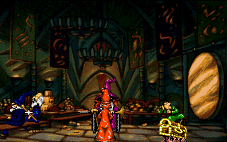
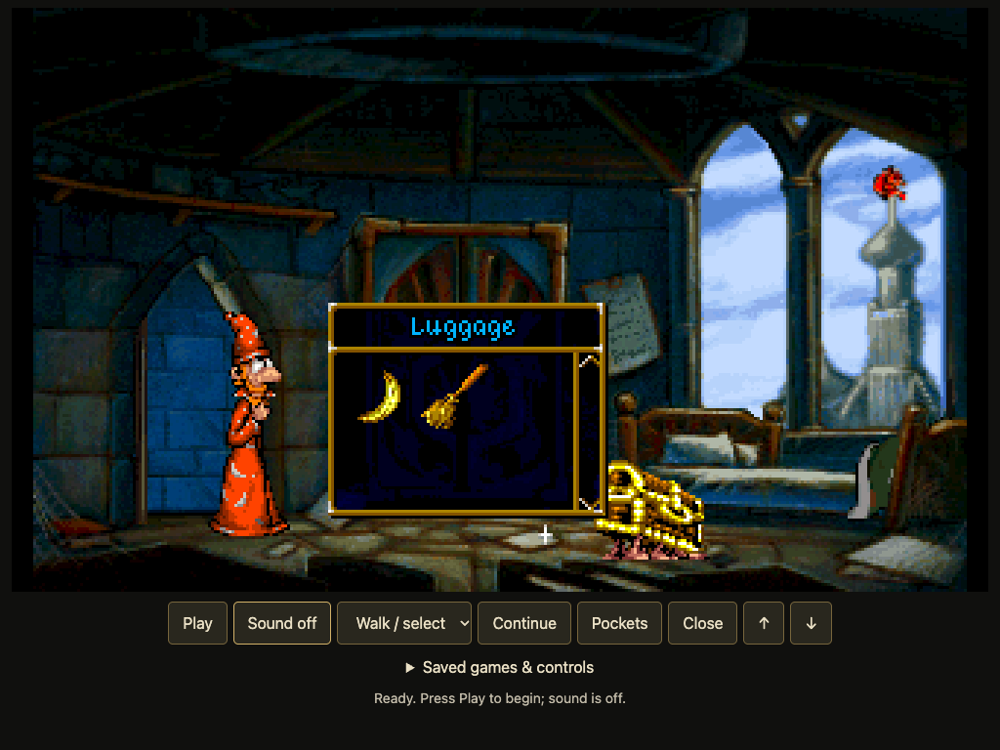
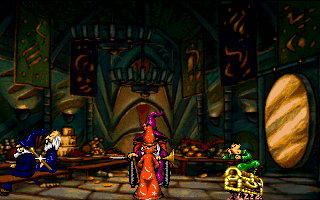
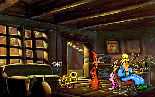
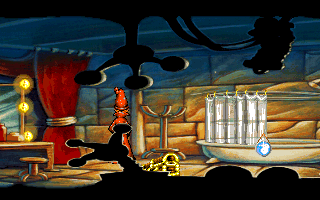
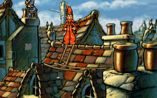
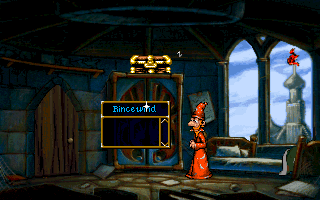
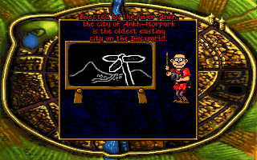

# Discworld — a Rust Tinsel runtime

A work-in-progress replacement for the **Tinsel 1** engine that runs the original **Discworld English DOS CD v2** assets and scripts. The goal is the complete game, from opening to credits, on native macOS and a shared browser/WebAssembly engine, ultimately playable on an iPad in landscape with touch controls.

**Currently:** runnable macOS and browser development hosts and a reproducible original-input route through Acts I–IV, the ending, scrolling credits, and restart to the title screen. **Not yet:** a complete compatibility implementation, iPad release, or fully validated native/browser save/load. This is an independent compatibility project, informed by a pinned ScummVM reference, not an official release or a clean-room implementation.

The corrected idle-clock runtime passes the complete 4,209-input route on native,
Chrome and WebKit, including the ending and scripted restart. Final engine bytes
and pixels match; native passes 7,615 engine and 7,615 audio-state save/load checks.
See [route evidence](docs/validation/idle-clock-complete-route.json) for scope and limitations.



*Animated montage of actual runtime framebuffer captures, not continuous gameplay footage. Original artwork belongs to its respective rights holders. The source distribution does not include playable game data.*

## Run on macOS

You need:

- Rust/Cargo with edition 2024 support. Development checks currently use Rust 1.95; the workspace declares Rust 1.85 as its minimum, but that minimum has not been independently verified.
- Xcode command-line tools and CMake (`brew install cmake`). The native host builds and statically links bundled SDL2; no separate SDL installation is required.
- Your own **English DOS CD v2 Discworld ISO**. Other releases have not been validated.
- A General MIDI `.sf2` SoundFont for software music synthesis. Development uses TimGM6mb; provide it separately and retain its license. Neither the ISO nor SoundFont is included.

```sh
git clone https://github.com/tampajohn/discworld.git
cd discworld
mkdir -p assets/soundfonts
```

Place your ISO in the repository root and your SoundFont at `assets/soundfonts/TimGM6mb.sf2`. The supplied launchers expect the ISO filename `Terry Pratchett's Discworld (1995)(Psygnosis).iso`. Double-click **Play Discworld.command**, or pass your own paths directly:

```sh
cargo run --release -p discworld-native -- \
  "/path/to/discworld.iso" "/path/to/gm.sf2" --room
```

`--room` simulates the opening before showing Rincewind's room. Omit it to watch the opening in real time. Add `--mute` to start silently; the SoundFont is still required. Runtime logs from the launchers are retained under `assets/logs/`.

### Native development archive

From a clean, committed checkout on Apple Silicon macOS:

```sh
python3 scripts/package-native.py assets/packages/discworld-native.tar.gz
```

Extract the archive and run its `discworld-native` executable with your ISO and
SoundFont paths as above (omit `cargo run --release -p discworld-native --`).
It contains the executable, exact project source, license notices and checksums.
This archive is a command-line development distribution. To build a Finder app
from the same clean Apple Silicon checkout:

```sh
python3 scripts/package-macos-app.py assets/packages/discworld-finder.zip
```

Extract the ZIP and open `Discworld.app`. Its launcher asks for your ISO and
SoundFont on each launch. Saves, named slots, preferences and `last-session.log`
live under `~/Library/Application Support/Discworld Rust/`. Use F7 to load a named
save or F9 for the quick save; launch does not automatically resume it.
The bundle is ad-hoc signed, not notarized. Extracted runtime checks pass;
visible Finder/file-picker interaction and other macOS versions remain unverified.
See [native distribution validation](docs/native-distribution.md). The latest local
Finder and browser packages are pinned to `3df76c8`; their extracted startup,
legacy-save, manifest, source, and signature checks are recorded in
[package evidence](docs/validation/packages-3df76c8.json). These archives exclude
game assets and are local build artifacts, not published downloads.

### Save and reload

Press **F6** to quick-save and **F9** to quick-load `discworld-save.dws` in the working directory. Choose a destination with `--save-file PATH`; its parent directory must exist. Relaunch with `--load PATH` to restore the engine and synthesizer together. Use the same ISO and SoundFont. These development saves are not compatible with ScummVM.

The native and browser hosts support the original menus: **F1** opens options, **F5**
opens Save, and **F7** opens Load. Use Escape to skip an escapable sequence or close a menu/inventory. The browser also offers Options and Escape buttons.
Close the native window to exit manual play. Native named slots are stored beside the quick-save path in
a directory with the `.slots` extension (default `discworld-save.slots`). Save
names use the original game font. Chrome and WebKit tests cover typing a named save and reloading through the
original menus, including touch input and backspace. In the browser Save menu,
tap **Type save name** to focus the on-screen keyboard input; the name stays in
the original game font. Physical iPad keyboard behavior remains unverified.
Automated end-to-end SDL click/typing validation is still pending. Preferences are atomically stored in `<save-stem>.settings.json` when Escape
returns from a submenu. Browser named slots and preferences use IndexedDB on the
current device. A restored game retains its checkpoint settings.
Music, speech, and effects volumes now apply independently; **M** still mutes the whole output when a menu is closed.

Separate-process tests reproduce engine/DSP state, frames, and mixed speech/music PCM exactly, including an open Luggage inventory with its background. Native startup load, F5 save, and F9 reload are visually verified at the ending credits; broader in-game and failure-recovery checks remain. Browser manual saves support import/export and IndexedDB; automatic asset persistence and autosave remain unfinished.

## Run in a browser

```sh
rustup target add wasm32-unknown-unknown
cargo install wasm-bindgen-cli --version 0.2.129 --locked
scripts/build-web.sh
python3 -m http.server 8765 --bind 127.0.0.1 --directory web
```

Open [the local player](http://127.0.0.1:8765), select your ISO and SoundFont,
and optionally import a `.dws` save. Press **Play**; sound starts off.
Game files are read locally. The browser uses the original engine-rendered
image, fonts and overlays. Choose Walk/select, Action or Look before tapping.
Pockets, Continue, Escape and Close also have touch buttons.

**Save on device** replaces one IndexedDB slot for this browser origin.
**Export save** downloads a portable file; clearing browser data can erase the
local slot. After reloading the page, select the ISO/SoundFont again and use
**Load device save**. Imported native saves require the same ISO and SoundFont.
Hidden pages pause; return and press Play to resume.

To create a portable browser ZIP from a clean, committed checkout:

```sh
python3 scripts/package-web.py assets/packages/discworld-web.zip
```

Extract it and serve the extracted directory with `python3 -m http.server 8765`.
The bundle includes the runtime, license notices, exact tracked source archive,
and a SHA-256 file manifest. Supply your own game ISO and music SoundFont.
The output path must not already exist. This is a development distribution;
physical iPad acceptance and broader compatibility remain unfinished.



The host is tested in Chrome and Playwright WebKit at a landscape tablet-sized viewport.
Actual iPad Safari simulator loading/rendering also matches native pixels, with
file-picker and gesture automation limitations. Physical iPad, interruption recovery,
long-run audio and full-route interactive browser acceptance remain unfinished.
The complete recorded route passes in Chrome and WebKit workers with final engine state
and pixels matching native exactly. See [browser evidence and limitations](docs/browser-runtime.md).

### Watch the development playthrough

Pass `--paused` to start a native session paused (including after `--from-tick` replay reconstruction); press **P** to resume. Replay reconstruction is not a persistent engine save.

Double-click **Watch Discworld.command** to replay the validated Acts I–IV route from Rincewind's room through the ending and credits, initially muted. It uses the corrected idle-clock input trace. The host pauses after the recorded route only when player control returns and scene fades finish; P resumes with manual controls. During playback, P pauses/resumes, F cycles 1×/4×/16×, M toggles sound, and Escape exits. This automated route does not establish complete interaction compatibility or physical iPad acceptance.

| Replay control | Action |
| --- | --- |
| **M** | Toggle sound |
| **P** | Pause/resume |
| **F** | Cycle 1×, 4×, and 16× speed |
| **F6**, **F9** | Quick-save, quick-load |
| **Esc** | Exit |

Accelerated replay is silent; returning to normal speed restores the selected sound setting. Manual game inputs are disabled during replay to preserve its recorded route. Seek to a different tick by reconstructing the preceding game state:

```sh
cargo run --release -p discworld-native -- \
  "/path/to/discworld.iso" "/path/to/gm.sf2" \
  --replay evidence/dining-staff-input.json --from-tick 340000 --mute
```

### Play interactively

Physical mouse input uses shared single/double-click timing; explicit development bindings remain available. Full input compatibility is still under validation.

| Control | Action |
| --- | --- |
| Mouse | Position the original game cursor |
| Single left click / **W** | Walk to a point or target; pick up/put down an inventory item |
| Double left click / **A** | Action on the pointed actor, object, or inventory item |
| Right click / **L** | Look at the pointed target |
| **I** | Open pockets |
| **Backspace** | Close inventory/conversation |
| Space / click during speech | Advance dialogue/waits |
| Click conversation icon | Choose a topic |
| Wheel / Up / Down | Scroll inventory by row |
| Page Up / Page Down; Home / End | Scroll inventory by page or to its ends |
| Scrollbar arrows/track | Scroll using the original inventory graphics |
| **M**, **P** | Mute, pause/resume |
| **Esc** | Skip an escapable sequence or close a menu/inventory |
| Close window | Exit manual play |

Point at the Luggage and use Action to open its inventory. Drag an inventory title bar to move its window, its scrollbar thumb to browse items, or its edges/corners to resize it. Double-click a resizable inventory title bar to maximize it or restore its previous size. Inventory actions execute the original item scripts; storage restrictions are game behavior. The renderer uses the game's fonts and graphics. Hover-label arbitration, interrupted resize edge cases, complete click/touch parity and physical iPad controls remain unfinished.

## What works, and what remains

| Area | Current evidence / limitation |
| --- | --- |
| Game resources | ISO reading, release identification, checked resource/chunk decoding; supplied release has 149 index entries and 1,732 chunk headers |
| Graphics | Indexed image decoding, animation films, CPU composition, original fonts, scenes, movement, inventory UI and indexed overlay backing; full palette lifecycle and all depth/timing cases remain unverified |
| Scripts | Original bytecode, library calls, cooperative scheduling, dialogue, inventory and scene transitions exercised by the recorded start-to-credits route; unsupported behavior stops explicitly |
| Audio | Original samples and XMIDI music through a local software synth; original hardware and native/browser fidelity are not established |
| Gameplay | Acts I–III completed in replay, including the altered-book theft, temple escape and Act III climax; Act III spell, Shades item, birthmark, moustache, upgraded sword and eye verified (6 of 6), including the sailor exchange, palette-changing birthmark animation and cart/beggar sequence; Act IV fuels, final showdown, ending, scrolling credits and restart verified in headless replay |
| State | In-memory scene save/restore and script-driven restart; [versioned snapshots](docs/save-state.md) audited across the full route, with core restoration tested across the full route; combined engine/DSP files pass separate-process opening and inventory tests; native startup load and F5/F9 visually verified at credits |
| macOS | Runnable native window/audio host with interactive and replay modes |
| Browser/iPad | [WASM boundary](docs/browser-runtime.md) runs the same engine; the complete recorded route passes in Node/WASM and Chrome/WebKit browser workers with final engine state and pixels matching native exactly; cross-platform DSP differs; worker/canvas/audio and local saves tested in Chrome, including a touch action; physical iPad and complete interactive browser acceptance remain |

The project favors compatibility over skipping unsupported script behavior. A passing replay demonstrates that route, not general equivalence with ScummVM. Replays resolve targets explicitly, so they also do not prove mouse hit testing or touch usability.

## Architecture

| Component | Responsibility |
| --- | --- |
| `crates/discworld-core` | Portable resource readers, VM, scheduler, engine state, movement, rendering and UI behavior; portable snapshot serialization |
| `crates/discworld-audio` | Sample/music rendering and SoundFont synthesis |
| `crates/discworld-native` | macOS development host using SDL2 and Rodio; queued keyboard/mouse input and visible replay |
| `crates/discworld-replay` | Shared strict recorded-input decoder and application for native/WASM validation |
| `crates/discworld-web` | WASM exports for engine advancement, original RGBA frames, stereo PCM, input and save/load |
| `crates/discworld-tools` | ISO/resource audits, diagnostics, frame export and headless interaction replay |
| `vendor/rustysynth` | RustySynth 1.3.7 with documented safe decoding changes and retained MIT license |
| `evidence/*-input.json` | Reproducible interaction routes, without embedded game resources |

Project Rust code forbids unsafe code. Native platform dependencies have their own bindings; this is not a claim that the complete dependency tree contains no unsafe code. The core is designed for shared deterministic simulation, but cross-platform equivalence still needs validation.

## Validate and reproduce

```sh
cargo test --workspace
cargo clippy --workspace --all-targets -- -D warnings
rustup target add wasm32-unknown-unknown
cargo check -p discworld-core --target wasm32-unknown-unknown
cargo build --release -p discworld-native
```

Inspect resources without modifying the ISO:

```sh
cargo run --release -p discworld-tools -- inspect-iso "/path/to/discworld.iso"
cargo run --release -p discworld-tools -- inspect-resources "/path/to/discworld.iso"
cargo run --release -p discworld-tools -- audit-images "/path/to/discworld.iso"
```

Replay a short route headlessly and export the final frame:

```sh
mkdir -p assets/previews
cargo run --release -p discworld-tools -- run-headless \
  "/path/to/discworld.iso" 10000 assets/previews/wardrobe-replay.png \
  - "/path/to/gm.sf2" 500 evidence/wardrobe-look-input.json
```

Use a **fresh output filename**: existing PNG/WAV outputs are not overwritten. `-` discards PCM while still synthesizing audio and checking clocks. The caller supplies the total simulation tick budget (a 32-bit unsigned integer). WAV capture is capped at 100,000 ticks because its PCM buffer accumulates in memory. Reports go to stdout as JSON and include scene/state/interaction diagnostics. Tick/scene progress checkpoints go to stderr every 100,000 ticks, followed by a terminal status line. Original game data is needed for these integration runs; unit tests do not require the ISO.

Input traces use strictly increasing, zero-based ticks and expected scene names. For example:

```json
[{"tick":8700,"scene":"rinceroo.scn","polygon":8,"event":"look"}]
```

The tools also support actors, world points, inventory cells, conversation topics and explicit window-closing events. Expected scenes and accepted interactions are checked. See the included traces and [runtime evidence](docs/text.md) for examples and limitations. Historical documentation names local report files that are deliberately excluded from this repository; reproduce the corresponding trace to generate reports locally.

## Screenshots

| University | Barber |
| --- | --- |
|  |  |
| Palace | Inventory scrolling |
|  |  |
|  |  |

These are actual 320×200 runtime captures from the supplied release, included to document implementation progress.

## Roadmap and reference material

The full objective remains start-to-credits gameplay, complete interaction and save/load behavior, tested native and browser hosts, and landscape iPad touch play. Upcoming work includes broader native save/load validation, browser/iPad validation, broader touch controls, reference comparisons, and coverage of interactions outside the completed route. No release date is promised.

- [Goal and milestones](docs/goal.md)
- [Resource formats](docs/resource-format.md), [script runtime](docs/script-runtime.md), [scheduling](docs/scheduling.md)
- [Runtime and puzzle evidence](docs/text.md), [controls](docs/control.md), [movement geometry](docs/polygons.md)
- [Audio](docs/audio-runtime.md), [music](docs/music.md)
- [Pinned reference setup](docs/reference-build.md)

The behavioral reference is [ScummVM Tinsel at `96b42d42bc8533953bdd701db059cc33c839a9ff`](https://github.com/scummvm/scummvm/tree/96b42d42bc8533953bdd701db059cc33c839a9ff/engines/tinsel). The reference checkout is not included. Historical evidence documents reflect the scope at the time of each investigation; this README summarizes current host capabilities.

## License and assets

Runtime source is **GPL-3.0-or-later**; see [LICENSE](LICENSE) and [NOTICE](NOTICE) for ScummVM attribution and third-party details. This is **not a clean-room implementation**. Vendored RustySynth retains its MIT license and [local change record](vendor/rustysynth/LOCAL_CHANGES.md).

Discworld game data, dialogue, artwork and audio remain proprietary and are not relicensed by this project. The documentary screenshots/GIF show original game artwork; the GPL source license does not grant rights to that artwork. Bring your own game files and SoundFont. ISO images, extracted assets, reference checkouts, generated audio and bulk local reports are excluded from version control.


For quieter audio with less mixer distortion, use the browser's **Reduce
distortion** button or add `--audio-headroom` to the native launch command.
This reduces the mix before clipping; it does not remove hiss from the original
recordings. The original mix remains the default.
